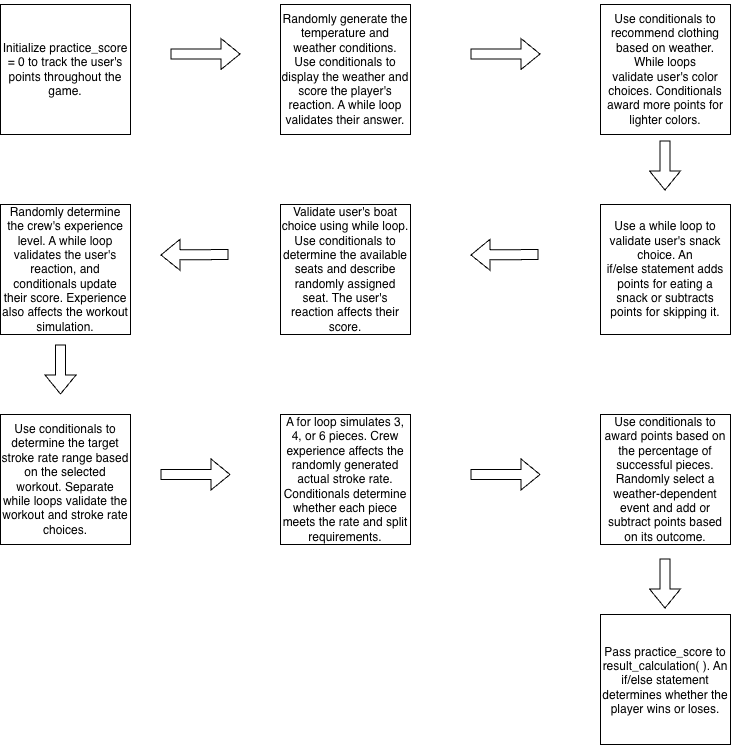

   <h1 align="center">Morning Rowing Practice Simulation</h1>
     
**Game Description:**   
This game simulates a morning rowing practice, where the user’s choices combined with randomness determine whether practice is successful or not. Throughout the game, the user chooses what to wear, what snack to eat, which boat to row in, and which workout to complete. Other aspects of practice, such as the weather, seat assignment, and crew experience level, are randomly generated. The user’s decisions and how the workout goes determine whether they win or lose the game.

**How to Play:**   
To play the game, run main.py and follow the instructions given in the terminal. The user will be prompted to make choices throughout practice and press Enter to move through certain parts of the game.

  
The user begins by finding out the weather and choosing how to react to it. They then select clothing colors, a pre-workout snack, and the boat they want to row in. After being randomly assigned a seat and finding out their crew’s experience level, the user chooses from a list of workouts and target stroke rates. The available target stroke rates depend on the workout selected, with easier workouts having lower stroke rate ranges and more intense workouts having higher ranges.

  
During the workout, the game simulates each piece by randomly generating an actual stroke rate and determining whether the boat meets the target split. The actual stroke rate generated depends on the crew’s experience level, with experienced crews staying closer to the target rate and less experienced crews having more variation. A piece is considered successful if the actual stroke rate is within two strokes per minute of the target and the boat meets its target split. Throughout the workout, the user presses Enter to reveal how each piece went and whether it was successful.

  
A random event also occurs during practice, which can positively or negatively impact the user’s score depending on the weather conditions. However, the player does not find out what happened until after the workout.

  
The player has five attempts to enter a valid answer for prompts that require input. If they enter an invalid answer five times, they automatically lose the game.

**Representing User State:**  
	The user’s state is represented by a variable called practice\_score, which is initialized to zero at the beginning of the game. An integer is used to track user state since their success can be measured by a running total of points earned or lost throughout the game.   

The score changes depending on the user’s reactions to different situations, clothing color choices, pre-workout snack choice, workout performance, and the random event. Positive decisions and successful outcomes add points, while negative decisions and unsuccessful outcomes subtract points. After each scoring opportunity, the game displays the user’s updated practice score so they can keep track of their progress.

At the end of the game, practice\_score is passed to the result\_calculation( ) function, which determines whether the user has earned enough points to win. The user needs to have accumulated eight or more points in order to win the game.

**Program Structure:**  
The game is organized into three Python files:

* **main.py:** Runs the game, collects the user’s decisions, and updates the practice score  
* **pre\_practice.py:** Contains the functions that lead up to the workout, including those for weather, clothing, snacks, boat selection, seat assignments, crew experience, and player reactions  
* **during\_practice.py:** Contains the functions related to the workout itself, including workout selection, simulation, random events, and determining the final result

**Control Flow:**

**Improvements After Peer Review:**

An issue that one of my peer reviewers noticed was that entering a string, float, or blank when asked for the target stroke rate would raise a ValueError and cause the program to crash. To fix this, I added a try-except block that catches these errors and allows the user to try again. If the user enters invalid input five times, they automatically lose the game. Another change I made was adding .strip() to my user inputs so that any extra spaces before or after an answer will not cause an otherwise valid response to be rejected. I also received feedback about the clarity of some rowing terminology, so I updated my docstrings to provide more explanation about what each function does, including any side effects it may have.